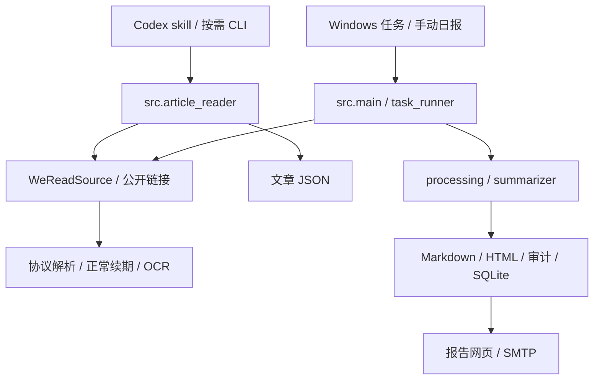

# 架构与文件索引

`src.article_reader` 是单次文章读取入口，`src.main` 是日报编排入口，二者共享配置、账号身份、访问状态、OCR 与 `data/run.lock`。技能的安装版仅是调用入口，指向克隆的项目，不复制会话文件。

| 模块 | 职责 |
|---|---|
| `src/article_reader.py` | `status/accounts/recent/read/login`，按需输出 JSON |
| `src/sources/weread.py`, `src/weread_protocol.py`, `src/weread_session.py` | 公众号身份、列表分页、正文解析、会话续期与保护 |
| `src/sources/base.py`, `cache.py`, `__init__.py` | 来源接口、限定容量的内容缓存、来源选择 |
| `src/sources/{composite,justone,wechat_download_api,rss,opencli,wordpress,article_library}.py` | 可选和历史来源；默认 WeRead 模式不调用 |
| `src/processing.py`, `src/summarizer.py` | 去重、分批抓正文、摘要、限制模型输入与输出 |
| `src/image_ocr.py`, `src/image_selection.py`, `src/html_utils.py` | 文本和图片、Windows OCR、图片评分缓存 |
| `src/report.py`, `src/report_images.py`, `src/report_viewer.py` | HTML/Markdown 报告，图片放大与本地浏览 |
| `src/report_image_refresh.py` | 只刷新历史附图，保留摘要和投递状态 |
| `src/main.py`, `src/task_runner.py` | 日报命令及 Windows 任务包装 |
| `src/state.py`, `src/file_utils.py`, `src/timeutils.py` | SQLite、进程互斥、原子替换、时间窗口 |
| `src/config.py`, `src/models.py`, `src/ssl_compat.py`, `src/logging_utils.py` | 配置、模型、安全证书信任和日志脱敏 |
| `src/mailer.py`, `src/diagnostics.py` | SMTP 发送与启动检查 |

主要脚本：`setup.ps1` 初始化本地模板、环境；`install_skill.ps1` 安装技能；`start_project.ps1`/`stop_project.ps1` 管理本地报告查看；`install_task.ps1`、`run_daily.ps1`、`task_schedule.ps1` 管理 Windows 任务；`probe_weread.py`、`collect_weread.py`、`probe_public_article.py` 用于有界诊断；`ocr_images.ps1` 调用 Windows OCR。`legacy/` 内脚本是旧数据源或实验工具，部分可能收费，`maintenance/` 内脚本用于离线维护。

## 本机数据（不提交）

`config/accounts.yaml`、`themes.yaml`、`public_feeds.json` 为由模板建立的本地配置，`data/` 存放会话、身份、健康记录、SQLite、审计和缓存，`reports/`、`logs/` 为运行产物，`.env` 为个人密钥和邮件配置。不要将这些文件复制进公开仓库或技能包。

## 效率与完整性

日报按组分页、按精确时间范围过滤，每批最多 6 篇正文、最多 3 个模型工作线程，处理后释放正文，缓存有限。模型并发不提升微信读书请求频率。列表存在缺失时停止该主题摘要，正文或摘要失败不发送不完整报告，邮件失败复用已生成报告。成功发送后自动调度在当日停止后续检查。查看服务仅绑定本机，默认不依赖旧 Docker 服务。

使用方法见 [OPERATIONS.md](OPERATIONS.md)，版本变更见 [CHANGELOG](../CHANGELOG.md)。
